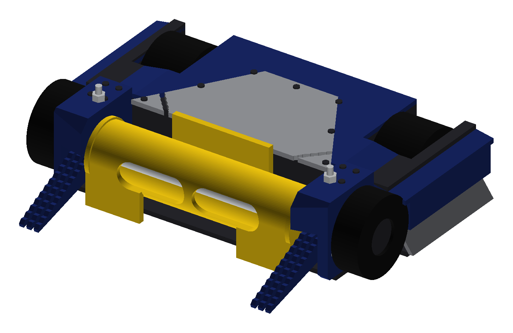
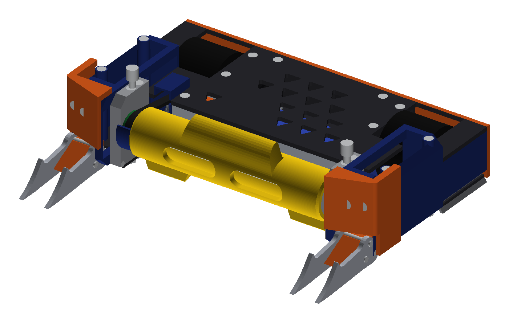

# Fusion 360 MCP + Claude Code: setup kit and build journal

This repo explains how to connect **Claude Code** to **Autodesk Fusion 360**, including on the free Personal licence, so Claude can build, import, colour, assign materials to and thread real CAD models in a live Fusion document.

It started as a combat-robotics project: a 3 lb (1360 g) drum-spinner beetleweight modelled from scratch by Claude. The robot's design files are **not** in this repo. It holds only the toolchain, the setup steps and what we learned along the way, so the same setup can be reused for any other project.

| First version (v001) | Second-last version (v016) |
|---|---|
|  |  |

The v001 model was a rough block-out. The v016 model has real motor and ESC models, an EN24 drum on a belt drive, Ti forks, a UHMW chassis, a CF top plate and TPU armour. It took 17 versions in about 5 days.

**Docs in this repo**
- [SETUP.md](SETUP.md): step-by-step install of the Fusion MCP server and add-in for Claude Code.
- [WORKFLOW.md](WORKFLOW.md): the pipeline that worked (build123d → STEP → Fusion) and the rules that keep Fusion from freezing.
- [CLAUDE_TEMPLATE.md](CLAUDE_TEMPLATE.md): a `CLAUDE.md` to drop into a new project so a fresh Claude session follows the same rules.
- [scripts/](scripts/): the reusable code. `prep_parts.py` runs locally in Python. The scripts in `scripts/fusion/` are sent to Fusion through the MCP `execute_code` tool.

---

## The journey

### Phase 1: code-only CAD, no Fusion connection (v001–v014)

**Stack**
- **Claude Code (Opus)** as the designer.
- Subagents ran in parallel for research: reverse-engineering the reference robot from match footage, part datasheets and vendor CAD.
- **[build123d](https://github.com/gumyr/build123d)** 0.13, a Python CAD kernel on OpenCascade, wrote every part as code in a local `.venv`.
- **Versioning:** each design iteration is a frozen folder (`v001/`, `v002/`, …) with a `params_vNNN.py` and a `model_vNNN.py`. A new idea never edits an old version.
- **Verification written in Python, because Claude can't look at Fusion:**
  - A custom z-buffer renderer turned the model into PNG views (iso, top, side, front) for Claude and the user to review.
  - Interference checks between every pair of solids.
  - A swept-volume clash check for the spinning drum.
  - Mass roll-up from density × infill per part, against the 1360 g limit.
  - An overall size check against the box limit.
- **Vendor parts:** the user's downloaded STEP files (gear motors, ESC boards and so on) went into the assembly at real size and mass.
- **Handoff to Fusion:** the user opened the exported STEP in Fusion by hand to look at it.

**Problems we hit**
- **Feedback was slow.** The user saw Fusion; Claude saw only its own renders. Every "the forks look bad" needed a screenshot back.
- **STEP imports looked flat:**
  - no thread geometry on the screws ("it's not perfect like a human does");
  - colours didn't survive reliably;
  - everything arrived as one lump of bodies with no names or materials.
- **Mounting holes and screws were wrong.** The user's review found bad hole layouts. That led to proper fastener engineering:
  - FE-based screw reactions per joint;
  - thread pull-out and bearing capacities;
  - cross dowels at the most-loaded screws;
  - 2D SIMP topology optimisation of the main rails with numpy/scipy, with the pocket shapes fed back into build123d.
- **The mass budget is a constant fight.** Every change needed a measured gram delta, not a guess.
- **Free-licence worry.** The user's question "Don't you need a paid version of Fusion 360?" had an answer: no. The scripting API and add-ins work on Fusion Personal. The real limit is a small number of active editable documents, so we kept Claude to **one dedicated document named `claude`** and never touched the user's other projects.

### Phase 2: Claude drives Fusion directly (v015–v017)

**Choosing an MCP server.** We looked at a few. We chose **[faust-machines/fusion360-mcp-server](https://github.com/faust-machines/fusion360-mcp-server)** (MIT, 93 tools including `execute_code`, `render_view` and `create_thread`).
- **Code review first:** before installing, Claude cloned it and reviewed commit `19b9f1e` (2026-10-06).
- **Network:** it talks only to localhost, with no outbound calls.
- **Risk:** the TCP socket on :9876 has no authentication, and `execute_code` runs arbitrary Python inside Fusion. So keep it bound to localhost.

**Setup snags.** Each one is fixed in [SETUP.md](SETUP.md).
1. **Claude's safety check blocked self-install.** Claude Code wouldn't install third-party code into Fusion or edit its own MCP config on its own, and correctly so. **The user ran the install commands** with the `!` prefix.
2. **The add-in was not in the list.** Fusion's Add-Ins dialog filters to "Fusion" sources by default. Tick **"From device"**, or add the folder with **+**.
3. **The server registered for the wrong project.** `claude mcp add` was run from `~`, so it was saved for that folder only. Fix: register with **`-s user`** so every project sees it.
4. **A restart is needed** after registering. Then `ping` returns `pong`.

**What changed once Claude could drive Fusion**
- **The model arrives finished:** every part is imported, named, coloured and given a material.
  - Each material's density is set so Fusion's own mass equals our mass budget per part.
  - Real **modelled ISO threads** go on the screws and bolts.
  - The version is saved with a descriptive label.
- **Claude sees what the user sees:** it renders Fusion views itself and checks them before reporting.
- **Iterations got faster:**
  - twin articulating forks on a pivot, swinging ±15°;
  - a needle-bearing drum axle with screwed-on covers;
  - screw rows rebuilt to the user's sketch.
  - Each one went from request to an updated Fusion model in one turn.

**Problems in phase 2.** These are the main lessons, written up as rules in [WORKFLOW.md](WORKFLOW.md).
- **Fusion froze** when deleting bodies that had about 46 modelled threads on them. The user had to restart Fusion.
  - **Rule:** delete thread features first, then the bodies, or clear the whole timeline.
- **Deleting one body inside a base feature removed 75 bodies.**
  - **Rule:** never edit inside the import base features. Clear and re-import.
- **The MCP call timed out (about 30 s)** on big imports.
  - **Rule:** import in batches of about 14–18 parts per call.
- **`importManager.importToMyDocument` is unreliable for multi-body STEP.**
  - **Rule:** use `importToNewDocument` → `TemporaryBRepManager.copy` → close that doc without saving → add the copies into a base feature in the target doc.
- **Thread creation fails on some bolts.**
  - Cause: odd cylinder faces, for example a countersunk head next to the shank.
  - **Rule:** create each thread in a `try`, check its `healthState`, and delete it if unhealthy.
- **Threads must go on last.**
  - **Rule:** save the document before adding threads, then save again after.
- **Safety:**
  - Always check `app.activeDocument.name == "claude"` before any edit.
  - Never use `delete_all`.
  - Never open the user's other designs.
- **The scratchpad gets wiped between sessions.**
  - **Rule:** keep helper scripts in the project (`tools/`), not in temp folders.

### What we'd tell the next project
1. Keep the **source of truth in code** (build123d, or whatever you model in) and treat Fusion as the viewer and finisher. Re-import a fresh model each version rather than editing Fusion geometry by hand.
2. Give Claude **one dedicated Fusion document**, and make every script check that document's name first.
3. Write **checks before features**: mass, interference, clearance and stress, with a pass or fail you can see in the report.
4. Approve **one configuration before building variants**. It saves hours of rework.

## Licence and credits
- The Fusion MCP server and add-in are © Faust Network, Inc., MIT. Get them from [their repo](https://github.com/faust-machines/fusion360-mcp-server); they are not copied here.
- The scripts in this repo are free to reuse.
